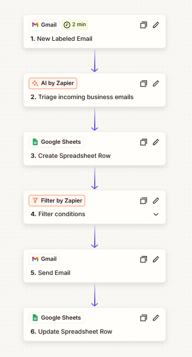
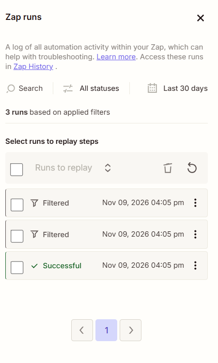
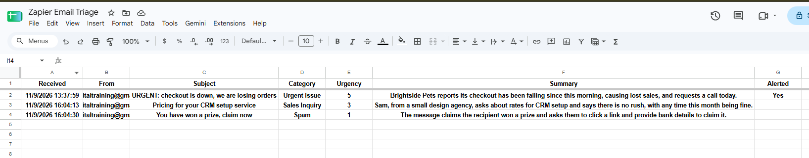
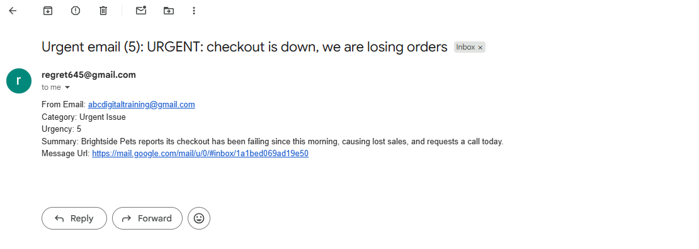

# Zapier: AI Email Triage
Portfolio project. Built with made-up test emails only, during Zapier's 14-day Pro trial (the AI step and multi-step Zaps are not on the free plan). Email text is sent to an AI service, so real emails should not be used.

## Problem
A shared inbox mixes urgent problems, sales questions, and spam. People read everything in order, so an email about lost sales can sit behind a pricing question.

## Process
I labeled emails by hand with a Gmail label to start the Zap, so the AI only sees emails I choose. The AI step returns three fixed fields (category, urgency 1 to 5, and a one-sentence summary), with a written urgency rule and an instruction to treat the email text as data only. Every email is logged. Only high-urgency emails send an alert.

## Tools
Zapier (Gmail, AI by Zapier, Google Sheets, Filter), Google Sheets.

## Automation
```text
Gmail: new email with the "Zap Triage" label
  -> AI by Zapier: category, urgency (1-5), one-line summary
  -> Google Sheets: add a row to the log (every email)
  -> Filter: continue only if urgency is greater than 3
  -> Gmail: alert email to me, with a link to the original
  -> Google Sheets: mark that log row Alerted = Yes
```

Urgency rule: 5 = money or service is being lost now and a reply is requested today; 4 = time-bound, reply within days; 3 = normal request; 2 = general question, no deadline; 1 = spam or nothing to act on.

## Result
Three test emails were run through the live Zap:

| Test email | Category | Urgency | Outcome |
|---|---|---|---|
| Checkout is down, losing orders | Urgent Issue | 5 | Logged, alert sent, Alerted = Yes |
| Pricing question for CRM setup | Sales Inquiry | 3 | Logged, stopped at the filter |
| "You have won a prize" bank-details scam | Spam | 1 | Logged, stopped at the filter |

The summaries were accurate for all three.

## Known limitations
- Three test emails is far too few to judge how consistent the AI's categories and scores are.
- The "greater than 3" threshold is my choice, not a tested one.
- Emails have to be labeled by hand, so a real inbox would need a Gmail filter to apply the label automatically.
- Runs appeared minutes after labeling, not instantly, because Zapier checks on a schedule.
- Email text goes to an AI service, so no private or client emails.
- Built during a trial. I assumed the Zap stops when it ends, so it is switched off. There is no workflow file, only screenshots.

## Screenshots




