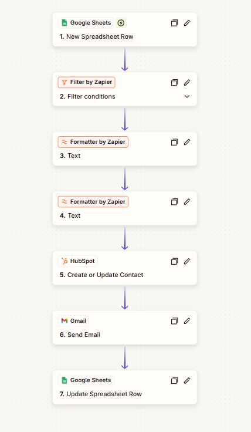
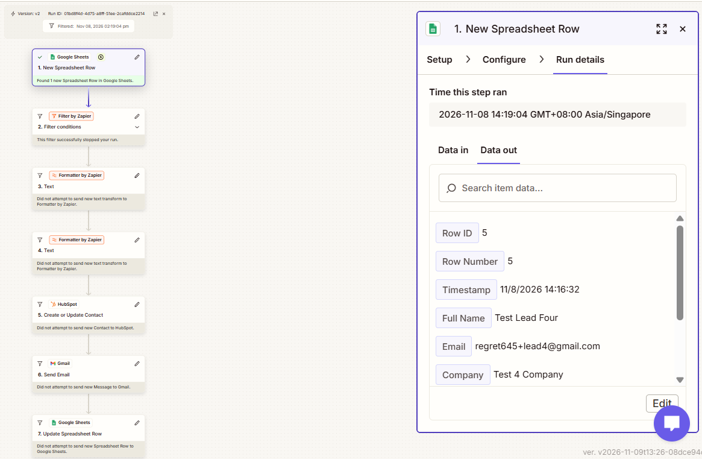
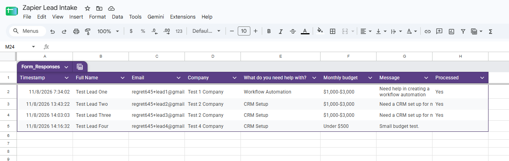
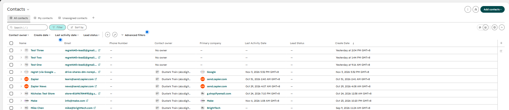

# Zapier: Lead Intake to HubSpot
Portfolio project. Built with test leads only (fake names and email addresses), during Zapier's 14-day Pro trial. The free plan only allows two-step Zaps, so this 7-step Zap needed the trial.

## Problem
Leads from a web form land in a spreadsheet, and someone has to read each row, decide whether it is worth following up, retype it into the CRM, and remember to tell the team.

## Process
Built a lead form with two dropdown questions (what the lead needs, and their monthly budget) so the filter never has to interpret free text. Both are required, so an empty answer cannot slip past the filter. Each step was tested in the editor before turning the Zap on, then run with real form submissions.

## Tools
Zapier (Google Sheets, Filter, Formatter, HubSpot, Gmail), Google Forms, HubSpot free CRM.

## Automation
```text
Google Sheets: new row (form response)
  -> Filter: continue only if budget is not "Under $500" and need is not "Not sure yet"
  -> Formatter: first name from the full name
  -> Formatter: last name from the full name
  -> HubSpot: create or update contact (email, first name, last name, company, message)
  -> Gmail: notification email to me
  -> Google Sheets: mark the row Processed = Yes
```

"Create or update" was chosen over "create" so the same email arriving twice updates one contact and does not create a duplicate.

## Result
- Two qualified test leads each became a HubSpot contact with the correct email and company, produced a notification email, and had Processed set to Yes.
- One test lead with a budget of "Under $500" was stopped at the filter. The run history shows it as Filtered, and the later steps show "did not attempt". No contact or email was created and Processed stayed empty.

## Known limitations
- Only the budget rule of the filter was tested with a blocked lead. The "Not sure yet" rule was not.
- The name split takes the first and last word, so middle names are dropped, and a one-word name fills both fields.
- Zapier checks the sheet on a schedule, so runs appeared roughly 15 to 20 minutes after each submission, not instantly.
- Test data only. Nothing was run against real leads.
- Built during a trial. I assumed the multi-step features stop when it ends, so the Zap is switched off.
- Zapier gives no JSON export for a Zap as far as I know, so there is no workflow file, only screenshots.

## Screenshots




